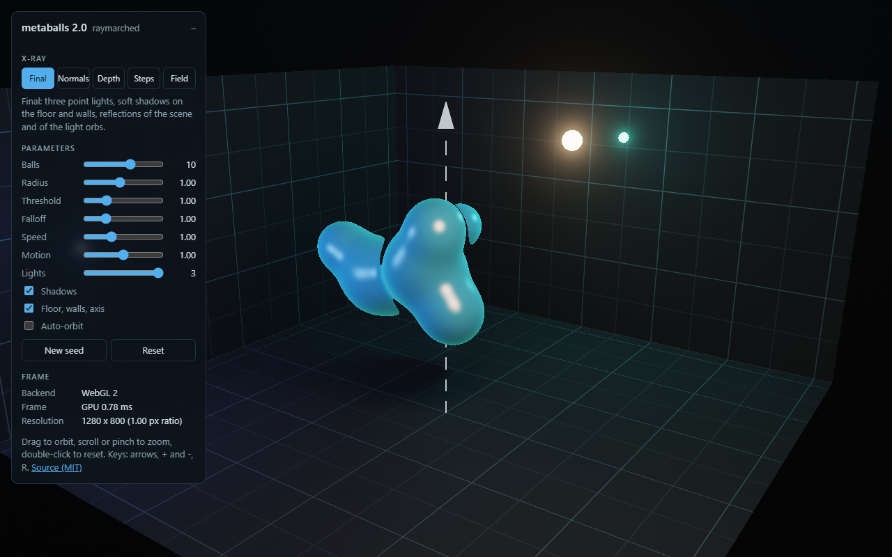

# metaballs

Metaballs 2.0: raymarched metaballs in the browser, minimal dependencies; a C++/HLSL port is welcome.



## What it is

- A small WebGL 2 demo of raymarched metaballs: orbit camera, three point lights that show up in the reflections, soft
  shadows, a minimal scene for scale (floor, two walls, a dashed vertical axis), exposed parameters, and an X-ray view of
  what the shader computes (normals, depth, step count, a slice of the field).
- Plain JavaScript and GLSL, no framework, no bundler. Open `index.html` and it runs (also from `file://`).
- Three files: `metaballs.js` (the renderer; half of it is the shader), `demo.js` (the control panel) and `index.html`.

## What it is not

- Not a game engine, not a physics library, not a production renderer.
- Not optimized for mobile GPUs yet. Slow frames lower the resolution (down to half), that is all.

## The field

A 2018 C++/OpenGL particle system extracted these metaballs with marching cubes from
`F(p) = sum r_i^2 / |p - c_i|^2` at `F = 1`. Version 2.0 keeps that field, adds a falloff exponent `k` and renders it
with sphere tracing instead of a mesh:

```
F(p)  = sum_i (r_i^2 / |p - c_i|^2)^k          surface: F(p) = threshold
-grad = sum_i 2k f_i (p - c_i) / |p - c_i|^2   the normal, analytic
step  = rho * (F^(-1/2k) - threshold^(-1/2k))  exact distance for one ball, shorter where balls merge
```

The march stops when `F` crosses the threshold, then six bisection steps find the surface. Rays that miss a bounding
sphere around the balls do not march at all.

## Controls

| Input | Action |
|---|---|
| Drag | orbit |
| Scroll, pinch | zoom |
| Double-click, `R` | reset the view |
| Arrows, `+`, `-` | orbit and zoom with the keyboard (canvas focused) |
| `1` to `5` | X-ray: Final, Normals, Depth, Steps, Field |

Parameters: balls (1-16), radius, threshold, falloff `k`, speed, motion, lights (1-3), shadows, scene, auto-orbit, seed.
Every one can go in the URL: `index.html?count=6&blend=1.6&mode=field`.

## Use it in your page

```html
<canvas id="c" style="width: 100%; height: 400px"></canvas>
<script src="metaballs.js"></script>
<script>
  const mb = Metaballs.create(document.getElementById('c'), {
    params: { count: 8, blend: 1.3 },   // any of Metaballs.PARAMS
    mode: 'final',                      // or one of Metaballs.MODES
    touchAction: 'pan-y',               // inside a scrolling page: vertical swipes keep scrolling
    onStats: (s) => console.log(s.gpuMs, s.frameMs)
  });
  if (!mb) { /* no WebGL 2: show an image instead */ }
  mb.set({ speed: 0.5 }); mb.setMode('normals'); mb.stop(); mb.start(); mb.destroy();
</script>
```

The loop only runs while something moves: with speed 0, auto-orbit off and nobody dragging, it draws nothing.
`prefers-reduced-motion` starts it with speed 0 and auto-orbit off.

## Porting to C++/HLSL

Everything that matters is the `FRAGMENT` string in `metaballs.js`. The CPU side only animates the ball centres
(`updateBalls`), computes the bounding sphere (`updateBound`) and builds the camera basis (`updateCamera`).
For HLSL: `vec3` is `float3`, `mix` is `lerp`, `fract` is `frac`, uniforms go into a constant buffer, and
`gl_FragCoord.y` grows upwards while `SV_Position.y` grows downwards.

## Status

Version 2.0 runs in current browsers with WebGL 2 (Chrome, Edge, Firefox, Safari 15+). If you want to port it to
C++/HLSL, open an issue first so we can agree on scope.

## Contributing

- Issues: yes, please. Bug reports and questions are welcome.
- Pull requests: only after an issue has been opened and discussed. Unsolicited pull requests may be closed without review.
- This is a small, personal project maintained in spare time. Replies can take a while.

## License

MIT. See `LICENSE`.
